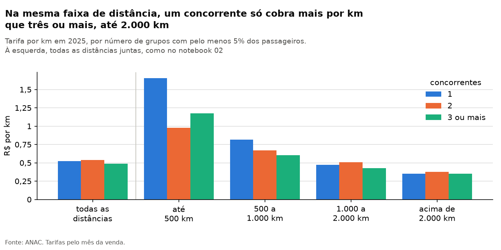
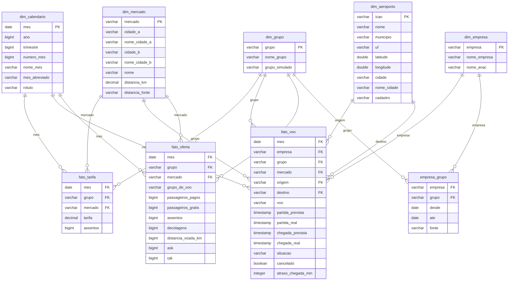
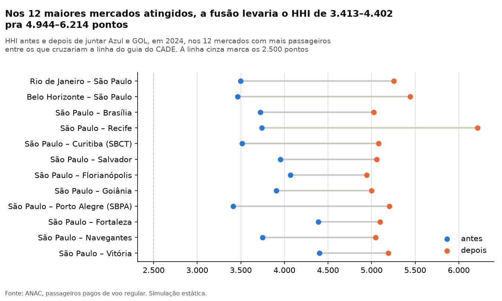
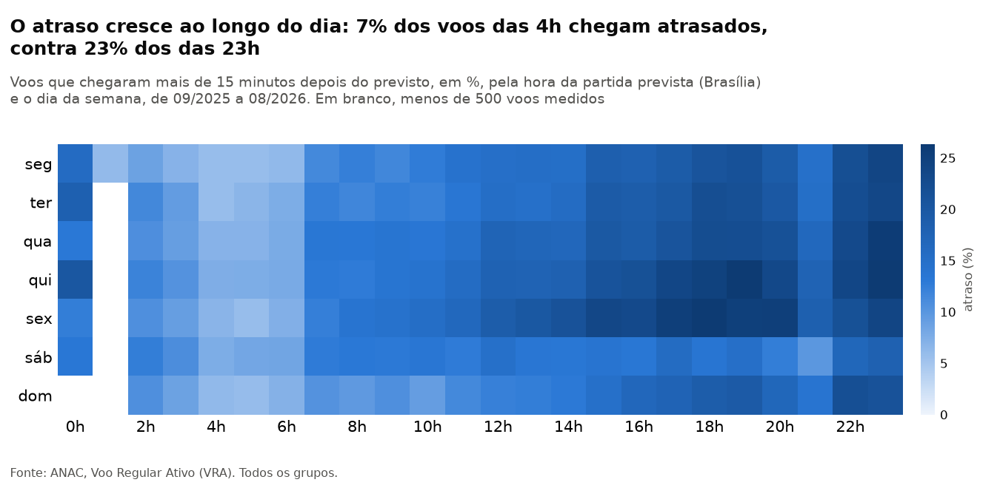
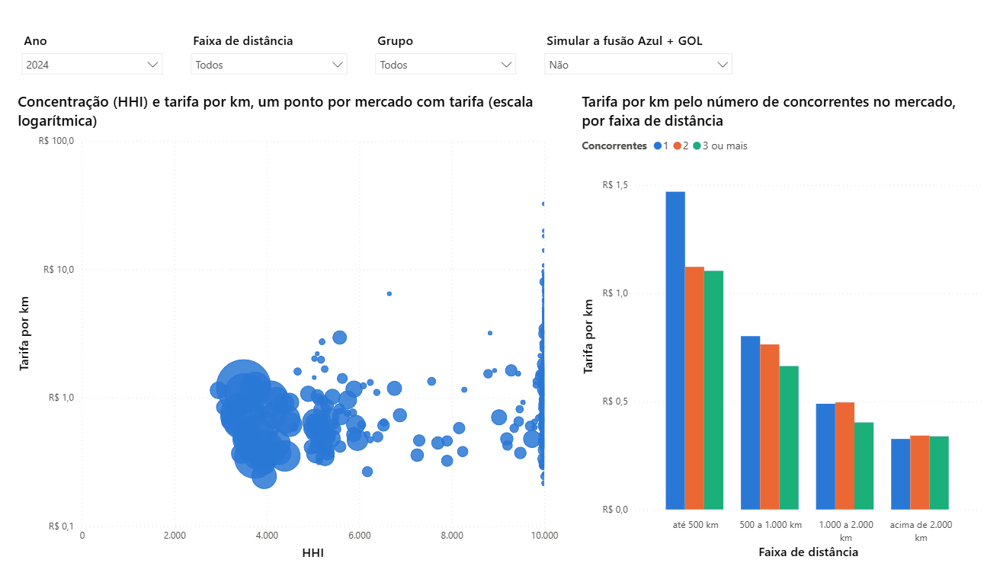

# Voos em números

[](https://github.com/ivadivad/voos-em-numeros/actions/workflows/testes.yml)
[](https://github.com/ivadivad/voos-em-numeros/actions/workflows/atualizar.yml)

Análise do mercado doméstico de aviação no Brasil com dados abertos da Agência
Nacional de Aviação Civil (ANAC). O projeto investiga a relação entre
concorrência, tarifas aéreas e pontualidade, com dados reproduzíveis,
transformações em SQL e um painel em Power BI.

> **Concluído: as etapas 0 a 12 estão feitas** (ver [Etapas](#etapas)). As
> perguntas foram escritas antes de abrir os dados, e o painel continua
> recebendo os meses novos sozinho.

O que tem aqui:

- **Um coletor em Python**, só com a biblioteca padrão, que baixa as quatro
  bases e guarda o sha256 de cada arquivo, pra perceber quando a ANAC
  revisa um mês já publicado.
- **Um modelo estrela em SQL**, no DuckDB, com testes de qualidade que rodam
  a cada construção, e os marts que os notebooks e o painel leem.
- **[Cinco notebooks](#os-notebooks)**: a validação da base contra os
  números que a ANAC publica, e quatro análises das três perguntas, cada
  uma com o que ela não prova escrito junto.
- **[Um painel do Power BI](#o-painel)** salvo como projeto em texto (TMDL e
  PBIR), com um botão que simula a fusão Azul + GOL.
- **[Uma atualização mensal](#atualização-automática)** no GitHub Actions,
  que coleta, reconstrói e publica os marts novos pro painel, enquanto a
  análise fica presa à coleta em que foi escrita.

## A pergunta

**A falta de concorrência deixa a passagem aérea mais cara no Brasil?**

1. Em mercados com menos companhias, a tarifa por quilômetro é mais alta,
   comparando distâncias parecidas?
2. Se a fusão Azul + GOL tivesse acontecido, quantos mercados passariam dos
   limites de concentração do CADE, e quantas pessoas voariam neles?
3. Pagar mais caro compra pontualidade?

O período começa em janeiro de 2019. Os números deste README e dos
notebooks vão até ago/2026, da coleta de 13/10/2026; o painel segue o
último mês publicado pelas fontes.

### As respostas

1. **Sim, como associação.** Comparando mercados de distância parecida, a
   tarifa por quilômetro é de 27,1% a 39,5% mais alta onde só um grupo voa
   do que onde há três ou mais, e a diferença vem dos mercados de até
   2.000 km ([notebook 03](notebooks/03-comparar-o-comparavel.ipynb)).
2. **79 mercados em 2024**, de 503, passariam da linha do guia do CADE com a
   fusão Azul + GOL, e neles voaram 67,4 milhões de passageiros de voo
   regular, contados a cada voo: 74,8% do total. Nos 12 meses mais
   recentes, seriam 66 de 467, com 72,5 milhões, 71,0%
   ([notebook 04](notebooks/04-fusao.ipynb)).
3. **Não de forma consistente.** Nos 12 meses mais recentes, os grupos que
   cobram mais por km num mercado atrasam um pouco menos (correlação de
   Spearman de −0,090), mas a associação é fraca, não aparece dentro de
   nenhum dos três maiores grupos e muda de sinal de um ano pro outro
   ([notebook 05](notebooks/05-pontualidade.ipynb)).

As ressalvas das três respostas estão em [Limitações](#limitações).



Com todas as distâncias juntas (à esquerda), um concorrente só cobra 6,9% a
mais por km que três ou mais: os mercados de um concorrente são mais longos,
e o quilômetro do mercado longo é mais barato. Separando por faixa, a
diferença vai a 40,6% até 500 km e some acima de 2.000 km.

## Os notebooks

Cada um abre no Colab sem instalar nada. Os dados vêm dos marts da coleta
de 13/10/2026, pela tag
[`coleta-2026-10-13`](https://github.com/ivadivad/voos-em-numeros/tree/coleta-2026-10-13)
do GitHub: rodado de novo, o notebook dá as saídas que estão gravadas nele.

| Notebook | O que faz | |
|---|---|---|
| [01 — Validação da base](notebooks/01-validacao.ipynb) | Confere a base contra os números que a ANAC publica: totais, tarifa média e yield | [](https://colab.research.google.com/github/ivadivad/voos-em-numeros/blob/main/notebooks/01-validacao.ipynb) |
| [02 — Concorrência e preço](notebooks/02-concorrencia-e-preco.ipynb) | A comparação crua, sem controle, entre o número de concorrentes e a tarifa por km | [](https://colab.research.google.com/github/ivadivad/voos-em-numeros/blob/main/notebooks/02-concorrencia-e-preco.ipynb) |
| [03 — Comparar o comparável](notebooks/03-comparar-o-comparavel.ipynb) | A mesma comparação entre mercados de distância parecida, por faixa e numa regressão (pergunta 1) | [](https://colab.research.google.com/github/ivadivad/voos-em-numeros/blob/main/notebooks/03-comparar-o-comparavel.ipynb) |
| [04 — A fusão que não aconteceu](notebooks/04-fusao.ipynb) | O HHI de cada mercado com Azul e GOL juntas, pela régua do CADE (pergunta 2) | [](https://colab.research.google.com/github/ivadivad/voos-em-numeros/blob/main/notebooks/04-fusao.ipynb) |
| [05 — Pontualidade](notebooks/05-pontualidade.ipynb) | Quem atrasa mais, onde e em que horário, e se a tarifa mais alta compra pontualidade (pergunta 3) | [](https://colab.research.google.com/github/ivadivad/voos-em-numeros/blob/main/notebooks/05-pontualidade.ipynb) |

## Fontes

Todas as bases são abertas e publicadas pela ANAC. O que cada uma traz, linha
a linha, está no [`DICIONARIO.md`](DICIONARIO.md).

| Base | Conteúdo | Fonte |
|---|---|---|
| Tarifas aéreas domésticas | Valores de tarifa vendidos por empresa, origem, destino e mês da venda, com os assentos vendidos a cada valor | [Página do conjunto](https://www.gov.br/anac/pt-br/acesso-a-informacao/dados-abertos/areas-de-atuacao/voos-e-operacoes-aereas/tarifas-aereas-domesticas). Arquivos em `https://sas.anac.gov.br/sas/tarifadomestica/AAAA/AAAAMM.csv` |
| Voo Regular Ativo (VRA) | Etapas de voo, com horários previstos e realizados e cancelamentos | [Página do conjunto](https://www.gov.br/anac/pt-br/acesso-a-informacao/dados-abertos/areas-de-atuacao/voos-e-operacoes-aereas/voo-regular-ativo-vra) |
| Dados estatísticos | Passageiros, assentos, decolagens e distância por empresa, par de aeródromos e mês | [Página do conjunto](https://www.gov.br/anac/pt-br/acesso-a-informacao/dados-abertos/areas-de-atuacao/voos-e-operacoes-aereas/dados-estatisticos-do-transporte-aereo) |
| Aeródromos públicos | Código, cidade atendida e coordenadas de cada aeródromo | [Página do conjunto](https://www.gov.br/anac/pt-br/acesso-a-informacao/dados-abertos/areas-de-atuacao/aerodromos/aerodromos-publicos/lista-de-aerodromos-publicos) |

### Notas sobre as fontes

Conferido em 13/10/2026.

| Base | Último mês publicado | Prazo documentado | O que se observou |
|---|---|---|---|
| Tarifas | ago/2026 | As empresas registram as tarifas "até o dia 10 (dez) do mês subsequente" ([Resolução ANAC nº 780/2025](https://www.anac.gov.br/assuntos/legislacao/legislacao-1/resolucoes/2025/resolucao-780), em vigor desde 01/02/2026). Não há prazo para a ANAC publicar | De fev a ago/2026, o arquivo apareceu de 15 a 28 dias depois do fim do mês (data de modificação de cada um). O de jan/2026 saiu junto com o de fev, em 20/03 |
| VRA | ago/2026. A pasta de set/2026 já existe, vazia | Os metadados dizem só "Mensal" | As pastas de mai, jun e jul/2026 têm data do dia 28 do mês seguinte, sempre às 04h09 |
| Dados estatísticos | ago/2026 | As empresas enviam os dados "até o dia 10 do mês subsequente ao de referência" ([metadados](https://www.gov.br/anac/pt-br/acesso-a-informacao/dados-abertos/areas-de-atuacao/voos-e-operacoes-aereas/dados-estatisticos-do-transporte-aereo/48-dados-estatisticos-do-transporte-aereo)) | O zip de ago/2026 foi gerado em 14/09/2026. O arquivo acumulado é regerado com frequência: a data dele era a do dia da conferência |
| Aeródromos | Lista de 01/10/2026 | "Aproximadamente a cada 40 dias" ([metadados](https://www.gov.br/anac/pt-br/acesso-a-informacao/dados-abertos/areas-de-atuacao/aerodromos/aerodromos-publicos/lista-de-aerodromos-publicos/metadados-do-conjunto-de-dados-lista-de-aerodromos-publicos-v2)) | É um retrato da lista atual, sem versão por mês |

Comportamentos que custaram tempo para descobrir, registrados para quem for
usar as mesmas bases:

| Comportamento | Detalhe |
|---|---|
| A ANAC substitui arquivos antigos | Meses de tarifas de 2023 e de 2024 têm data de mar/2026; quase todo o VRA, de 07/10/2026. É por isso que o coletor da etapa 2 registra o sha256 de cada arquivo baixado. Na base estatística, a troca muda dado: entre 13 e 22/10/2026, ago/2026 ganhou 48.039 passageiros pagos |
| As listas de aeródromos mudam mais do que os metadados dizem | "Aproximadamente a cada 40 dias", pelos metadados; em out/2026, a de públicos foi trocada 14 dias depois da anterior, e a de privados teve três versões em dez dias |
| O formato das tarifas muda de um mês para outro | Cinco versões de cabeçalho, vírgula ou ponto decimal, fim de linha do Windows ou do Linux. Só a ordem das sete colunas é constante |
| Mai/2026 das tarifas tem outro nome | `202605.csv` dá 404; o arquivo publicado é `202605 (1).CSV` |
| Fev e mar/2020 do VRA estão corrompidos | Todas as linhas trazem o texto `Microsoft.SqlServer.Dts.Pipeline.BlobColumn` no lugar dos horários. A versão descontinuada do histórico de voos tem os dois meses legíveis, em outro formato. O projeto deixa os dois meses de fora |
| A base estatística tem duas publicações | Zips mensais (passariam de 22 GB descompactados nos 92 meses) e um CSV acumulado de 360 MB com os mesmos números agregados por mês |
| O gov.br recusa o User-Agent padrão do Python | A página do VRA devolve 403 para `Python-urllib`. Com um User-Agent que identifica o projeto, devolve 200 |
| VRA e lista de aeródromos não começam pelo cabeçalho | A primeira linha é `Atualizado em: AAAA-MM-DD` |

## O que é um mercado

A concentração (HHI) e o número de concorrentes são medidos por mercado, e o
resultado depende de como o mercado é definido. Aqui, **mercado é um par de
cidades, sem direção**.

**Par de cidades, não de aeroportos.** Quem vai de São Paulo ao Rio escolhe
entre Congonhas, Guarulhos e Viracopos de um lado, e entre Santos Dumont e
Galeão do outro. Em ago/2026, essa viagem somou 619.821 passageiros pagos,
espalhados por seis pares de aeroportos; o maior deles, Congonhas–Santos
Dumont, ficou com 54%. Tratar cada par como um mercado partiria um mercado
só em seis e faria uma empresa parecer sozinha numa rota em que disputa o
mesmo passageiro com quem voa do aeroporto ao lado.

Os aeroportos de uma mesma cidade seguem os códigos de cidade da IATA: SAO,
RIO e BHZ, na tabela [`dados/referencia/mercados.csv`](dados/referencia/mercados.csv).
Qualquer outro aeroporto é o próprio mercado.

**Sem direção.** São Paulo → Rio e Rio → São Paulo são o mesmo mercado. Em
ago/2026, os dois sentidos tiveram quase o mesmo número de passageiros
(311.583 e 308.238). Nos 262 mercados com mais de mil passageiros naquele mês,
a ida e a volta diferiram, na mediana, 5,6% em relação à média dos dois
sentidos. Separar os sentidos dobraria o número de mercados sem acrescentar
informação.

**Escolhas que podem ser discutidas:**

- Viracopos fica em Campinas e é o aeroporto de quem mora lá. Entra em SAO
  porque a IATA o põe lá; tirá-lo é um teste de sensibilidade possível.
- Voo entre dois aeroportos do mesmo mercado (Guarulhos–Viracopos, por
  exemplo) não forma mercado e fica de fora.
- Jacarepaguá e Campo de Marte não estão nos grupos da IATA e continuam como
  mercados próprios.
- A tarifa é registrada pela viagem do passageiro, e o passageiro da base
  estatística, por voo. Um mesmo mercado mede as duas coisas de jeitos
  diferentes, como explica o [`DICIONARIO.md`](DICIONARIO.md).

## O modelo

As três bases viram um modelo estrela no DuckDB: um fato por base e as
dimensões que os três compartilham. As dimensões também vão pra
`dados/marts/dim_*.parquet`, pro painel usar as mesmas tabelas que o SQL.
Os fatos ficam só no banco, grandes demais pro Git (o das tarifas tem 34
milhões de linhas), e os marts das análises e do painel saem deles.



| Tabela | Uma linha é |
|---|---|
| `fato_tarifa` | um grupo, um mercado, um mês da venda e um valor de tarifa, com os assentos vendidos por esse valor |
| `fato_voo` | um voo do VRA, com os horários, a situação e o atraso na chegada |
| `fato_oferta` | um grupo, um mercado, um mês e um grupo de voo (regular, não regular ou improdutivo), com passageiros, assentos, decolagens, ASK e RPK |
| `dim_calendario` | um mês, de jan/2019 a ago/2026 |
| `dim_grupo` | um grupo econômico (21), com o grupo da fusão simulada: Azul e GOL viram um só |
| `dim_empresa` | uma empresa das três bases (24) |
| `empresa_grupo` | uma empresa num período, com o grupo a que ela pertencia nele |
| `dim_mercado` | um par de cidades sem direção, com a distância (8.983) |
| `dim_aeroporto` | um aeroporto das três bases, com a cidade do mercado (306) |

Os números são da coleta de 13/10/2026. Três decisões pesam no resto da
análise:

**O grupo econômico muda no tempo.** A concentração é medida entre donos,
não entre marcas, e duas empresas trocaram de dono dentro do período: a
TwoFlex, hoje Azul Conecta, é da Azul a partir de jun/2020, e a MAP, da
VoePass a partir de set/2019. Antes disso, cada uma é um grupo próprio. Por
isso o grupo não é uma coluna da `dim_empresa`: a `empresa_grupo` guarda os
períodos, e cada fato traz o grupo da empresa no mês da linha. A ligação de
cada empresa, com a fonte, está em
[`dados/referencia/grupos.csv`](dados/referencia/grupos.csv).

**A distância de um mercado** é a média das distâncias em linha reta entre
os aeroportos das duas cidades, ponderada pelos assentos vendidos no
período. Rio–São Paulo fica com 365,9 km, entre os 336,8 km de
Guarulhos–Galeão e os 406,8 km de Viracopos–Santos Dumont. Com esse peso,
a tarifa por quilômetro calculada pelo mercado dá, no período, o mesmo
R$ 0,4357/km da conta feita par de aeroportos a par. Os 18 aeroportos que
não estão nas listas de aeródromos da ANAC não têm coordenada: neles vale a
distância que a ANAC publica para voo direto, e 428 mercados, com 0,06% dos
assentos vendidos, ficam sem distância.

**O que fica de fora** é o par de aeroportos da mesma cidade, que não forma
mercado: 14 assentos das tarifas, 823 voos do VRA e 428.410 passageiros
pagos da base estatística, 94,5% deles em voos do grupo improdutivo que
voltaram ao aeroporto de onde saíram. Os testes de cada fato conferem que
ele, somado ao que ficou de fora, fecha exatamente com a staging.

## A fusão Azul + GOL

A segunda pergunta é sobre uma fusão que chegou a ser negociada e não
aconteceu. As datas, cada uma com a fonte:

| Data | O que aconteceu | Fonte |
|---|---|---|
| mai/2024 | Azul e GOL assinam um acordo de codeshare, a venda de assentos uma no voo da outra | [InfoMoney, 26/09/2025](https://www.infomoney.com.br/mercados/gol-desiste-de-processo-de-fusao-com-a-azul/): "as empresas também confirmaram a rescisão do acordo de codeshare, assinado em maio de 2024 para integrar suas malhas aéreas no Brasil" |
| 15/01/2025 | A Abra, controladora da GOL, e a Azul assinam um memorando de entendimentos não vinculante | [Fato relevante da GOL de 15/01/2025](https://static.poder360.com.br/2025/01/fato-relevante-azul-gol.pdf), cópia no Poder360: "a Abra e a Azul S.A. ("Azul") assinaram, na presente data, Memorandum of Understanding (Memorando de Entendimentos) (“MoU”) não vinculante com o objetivo de explorar uma combinação de negócios no Brasil" |
| 25/09/2025 | A Abra encerra as negociações, e as duas rescindem o codeshare | [Poder360, 26/09/2025](https://www.poder360.com.br/poder-economia/gol-e-azul-encerram-negociacoes-de-fusao/): "O grupo Abra, controlador da GOL, anunciou na 5ª feira (25.set.2025) que encerrou as negociações para uma fusão com a Azul." |

**Como a fusão é simulada.** A `dim_grupo` tem um grupo simulado em que
Azul e GOL são um só, e o `sql/60_mart_fusao.sql` recalcula a
concentração de cada mercado com ele, em duas janelas de 12 meses: 2024, o
mercado que a fusão encontraria, e os 12 meses mais recentes. A leitura é a
da seção 2.4.2 do [guia de concentração horizontal do
CADE](https://cdn.cade.gov.br/Portal/centrais-de-conteudo/publicacoes/guias-do-CADE/guia-para-analise-de-atos-de-concentracao-horizontal.pdf)
([cópia no Internet Archive](https://web.archive.org/web/20260829025632/https://cdn.cade.gov.br/Portal/centrais-de-conteudo/publicacoes/guias-do-CADE/guia-para-analise-de-atos-de-concentracao-horizontal.pdf), de 29/08/2026),
e o projeto a usa como triagem, não como veredito: o próprio guia diz que
"A 'regra do HHI', como indicativa de nexo causal é uma suposição inicial,
sensível a outros argumentos". E a simulação é estática: soma as duas
companhias no mercado de cada janela, sem supor que alguém reaja, entre ou
saia. O resultado está no [notebook 04](notebooks/04-fusao.ipynb).



## Pontualidade

A terceira pergunta usa o Voo Regular Ativo (VRA) da ANAC: cada voo
doméstico regular de passageiros previsto, com os horários previstos e os
realizados. **Atraso é na chegada, acima de 15 minutos**, sobre os voos
realizados com os dois horários; acima de 30 e de 60 minutos entram como
sensibilidade. O cancelamento é sobre os realizados mais os cancelados, e
os 1.158 voos com situação `NÃO INFORMADO` (de ago/2020 a out/2023) ficam
fora da conta principal. A hora é a da partida prevista, no horário de
Brasília, que é o do VRA.

**A ordem dos grupos muda com o corte.** Em quatro dos oito anos da base
(2020, 2023, 2025 e 2026), quem atrasa mais ou menos depende de onde fica a
linha: em 2025, a LATAM é a que mais atrasa acima de 15 minutos, e a Azul,
acima de 30 e de 60. Por isso o projeto mostra os três cortes, e não um
ranking só. O detalhe está no [notebook 05](notebooks/05-pontualidade.ipynb).



## O painel

O painel do Power BI está em `powerbi/`, salvo como projeto (`.pbip`): o
modelo em TMDL e o relatório em PBIR, texto que o git versiona e mostra
linha a linha. Pra abrir:

1. Instale o Power BI Desktop (a versão de junho de 2026 ou uma mais nova).
2. Abra `powerbi/voos-em-numeros.pbip`.
3. Clique em **Atualizar**. Na primeira vez, o Power BI pergunta como
   acessar `raw.githubusercontent.com`: deixe **Anônimo** e clique em
   **Conectar**. Os dados vêm dos marts deste repositório, pela URL do
   GitHub; nada depende da sua máquina. Antes de atualizar, as páginas
   aparecem vazias: o projeto guarda a definição do painel, não os dados.

São cinco páginas: a visão geral; concorrência e preço, com a dispersão
entre o HHI e a tarifa por km; a fusão Azul + GOL, com o botão que liga a
simulação; a pontualidade, com o corte de atraso (15, 30 ou 60 minutos)
como parâmetro; e o detalhe de um mercado, aberta pelo drill-through
(botão direito num mercado). Quem não tem Power BI vê as capturas em
[`graficos/painel/`](graficos/painel) ou num [PDF só](graficos/painel.pdf).



O botão da fusão na página de concorrência e preço, em 2024: desligado e
ligado. Os dois quadros são o Power BI Desktop desenhando a página; o eixo
do HHI fica fixo de 0 a 10.000, então o que anda são os mercados.

Quatro decisões do modelo:

- **As mesmas tabelas dos notebooks.** As cinco dimensões e os cinco marts,
  com as colunas e os tipos do parquet; o `teste_powerbi.py` confere isso e
  que cada relacionamento vale nos dados.
- **Média é razão entre somas.** A tarifa média e a tarifa por km saem das
  somas, como nos notebooks, e o HHI é calculado no período filtrado: em
  2024, com os dados de 13/10/2026, a página da fusão mostra os mesmos 79
  de 503 mercados do notebook `04-fusao`.
- **O calendário é mensal e não é marcado como tabela de datas.** O Power
  BI exige datas contínuas pra marcar, e as medidas não usam as funções de
  inteligência de tempo.
- **Números em português.** O relatório tem idioma próprio (pt-BR), que
  passa na frente do idioma do Windows e do navegador: R\$ 514,29, e não
  R\$ 514.29.

## Atualização automática

Todo dia 3, o workflow [`atualizar.yml`](.github/workflows/atualizar.yml)
do GitHub Actions baixa as quatro bases de novo, roda os testes,
reconstrói o modelo e commita na main o que mudou em `dados/`: o
manifesto, a cobertura e os marts. O painel lê os marts da main e pega o
mês novo ao clicar em **Atualizar**. A primeira rodada que publicou foi
disparada à mão em 22/10/2026, depois de três rodadas de teste, e trouxe o
que a ANAC tinha revisado desde 13/10: as listas de aeródromos e a base
estatística. A primeira agendada é a de 03/11/2026.

A análise não anda junto. Os notebooks leem os marts da tag
`coleta-2026-10-13`, e os números deste README são dessa coleta. O painel,
com dado mais novo, pode mostrar outro número: em 22/10/2026, a ANAC já
tinha revisado a base estatística, e Rio–São Paulo, em ago/2026, passou de
619.821 para 621.304 passageiros.

Como o workflow se protege:

- **O modelo só avança quando as três bases mensais têm o mês.** Em
  22/10/2026, as tarifas e a base estatística já iam até set/2026, e o VRA
  não: o modelo ficou em ago/2026, e set/2026 entra numa rodada seguinte.
- **Sem cache.** O GitHub apaga o cache que fica 7 dias sem uso, e a rodada
  é mensal: cada uma baixa as bases inteiras, de 72 a 85 minutos nas
  rodadas de teste, quase todos de download. O manifesto ganha linha só
  pro arquivo com sha256 novo, o que a ANAC revisou.
- **Os mesmos bytes no Linux.** Com os mesmos arquivos da ANAC, a
  construção do GitHub, em Linux, e a de uma máquina Windows deram os dez
  marts iguais, byte a byte, em 22/10/2026: mart que muda no commit do
  workflow é dado novo, não diferença de sistema.
- **Falhou, não publica.** Cada coleta tenta até três vezes, com 5 minutos
  entre elas. Se ainda assim uma coleta ou a construção falhar, nenhum
  mart muda, e o job fica vermelho na aba Actions. Mudar o workflow
  dispara uma rodada de teste, que coleta e constrói sem commitar.
- **Agendamento parado.** Num repositório público, o GitHub desliga o
  agendamento depois de 60 dias sem atividade; aí ele é religado na aba
  Actions.

## Limitações

O que as respostas não dizem. Cada ponto vem de um notebook, do
[`DICIONARIO.md`](DICIONARIO.md) ou de uma seção acima, onde está o detalhe.

- **A tarifa registrada não é toda passagem vendida.** Pelos
  [metadados](https://www.gov.br/anac/pt-br/acesso-a-informacao/dados-abertos/areas-de-atuacao/voos-e-operacoes-aereas/tarifas-aereas-domesticas/46-tarifas-aereas-domesticas),
  ficam de fora as passagens com descontos restritos a grupos e as de
  programas de milhagem, e os assentos registrados correspondem a "cerca de
  50% do movimento de passageiros pagos transportados". Se o preço pago
  fora do registro for diferente onde há menos concorrência, a diferença
  medida aqui não é a do preço pago por todo mundo.
- **Mercado é uma escolha de modelagem.** Par de cidades sem direção, com os
  aeroportos agrupados pelos códigos da IATA ([O que é um
  mercado](#o-que-é-um-mercado)). Outra definição, como o par de aeroportos
  ou Viracopos fora de São Paulo, muda quem conta como concorrente em parte
  dos mercados, e não foi testada. E a concorrência é medida pelo
  passageiro de voo direto: os mercados que só se ligam por conexão, com
  18,16% dos assentos vendidos, ficam fora dela.
- **Associação não é efeito.** Uma companhia entra onde espera ganhar, e um
  mercado pode ter um concorrente só porque não comporta dois. Comparar
  mercados mostra que tarifa e concorrência andam juntas (notebook 03), e
  que tarifa e atraso quase não andam (notebook 05), não que uma cause a
  outra.
- **A fusão é uma simulação estática.** Soma Azul e GOL no mercado de cada
  janela, sem ninguém reagir, entrar ou sair. Não é uma previsão do que
  teria acontecido.
- **O HHI é triagem, não veredito.** O próprio guia do CADE chama a regra
  do HHI de "suposição inicial, sensível a outros argumentos". Cruzar a
  linha quer dizer que o caso pediria uma análise mais funda, não que a
  fusão seria barrada.
- **Passageiro por voo, tarifa por viagem.** A participação de cada grupo
  vem do passageiro contado em cada voo, e o atraso, de quem operou o voo;
  a tarifa é da viagem do passageiro, de quem vendeu, no mês da venda. O
  codeshare põe a venda de um grupo no voo de outro.
- **O VRA tem buracos.** Fev e mar/2020 vêm corrompidos da fonte e ficam
  de fora, e os 1.158 voos com situação `NÃO INFORMADO` ficam fora da
  conta principal de atraso e cancelamento.

## O que falta

- **Efeito, e não só associação.** O passo seguinte pras perguntas 1 e 3 é
  tratar a saída de uma companhia como experimento natural: o mesmo
  mercado, antes e depois de um grupo sair dele.
- **Outras definições de mercado.** O par de aeroportos em vez do par de
  cidades, e Viracopos fora de São Paulo, como teste de sensibilidade. Já
  testados, sem mudar o quadro: o limite de 10% no lugar dos 5% pra contar
  como concorrente, e a conta com o fretamento junto (notebook 02).
- **Concorrência nos mercados só de conexão.** Os 18,16% dos assentos
  vendidos nesses mercados ficam fora da análise: medir quem disputa esse
  passageiro pediria o caminho da conexão, que as tarifas não trazem.
- **Fev e mar/2020 do VRA.** A versão descontinuada do histórico de voos
  tem os dois meses legíveis, em outro formato; trazer de lá fecharia o
  buraco.
- **Coordenadas de 18 aeroportos** que não estão nas listas de aeródromos
  da ANAC. Hoje vale a distância publicada pra voo direto, e 428 mercados,
  com 0,06% dos assentos vendidos, ficam sem distância.
- **No painel**, um mapa na página da fusão, que pediria coordenada pro
  mercado (hoje só o aeroporto tem). E o PDF junta as capturas das páginas:
  o Exportar para PDF do Desktop só se faz pela tela.

## Como reproduzir

Pra ver os resultados, não é preciso reproduzir nada: os notebooks abrem no
Colab e o painel no Power BI Desktop, os dois lendo os marts pela URL do
GitHub (os notebooks, os da coleta de 13/10/2026; o painel, os da main).
Pra refazer os marts a partir da ANAC, são três passos:

```bash
git clone https://github.com/ivadivad/voos-em-numeros.git
cd voos-em-numeros
pip install -r requirements.txt
python coletar.py todas   # 1. baixa as quatro bases: 2,8 GB, uns 22 minutos
python construir.py       # 2. monta o banco e os marts e roda os testes de SQL: uns 60 segundos
git status dados/marts    # 3. mostra se algum mart mudou
```

Com os mesmos arquivos da ANAC, nenhum mart muda: a construção grava o
mesmo arquivo, byte a byte. Se a ANAC revisou um mês, o
`dados/manifesto.csv` registra o sha256 novo, e o mart pode mudar junto. O
painel lê os marts publicados na main, e os notebooks, os da tag: um mart
reconstruído na sua máquina não aparece em nenhum dos dois. O detalhe de
cada passo vem a seguir.

### Coletar os dados

Só biblioteca padrão do Python 3, sem instalar nada:

```bash
python coletar.py todas                   # as quatro bases, de jan/2019 até o último mês publicado
python coletar.py tarifas --desde 202601  # uma base só, a partir de um mês
python coletar.py --listar                # as bases e de onde vem cada uma
python coletar.py todas --revisar         # baixa de novo o que já existe, pra achar arquivo revisado
```

Os arquivos vão para `dados/brutos/<base>/`, fora do git. São 2,8 GB:
tarifas 1,42 GB, VRA 1,07 GB, o acumulado da base estatística 0,36 GB e as
listas de aeródromos 1 MB. A primeira coleta completa, em 13/10/2026, levou
22 minutos. Rodar de novo só baixa o que falta. Os meses já baixados são pulados, e só os
arquivos sem mês (o acumulado da base estatística e as listas de
aeródromos) vêm de novo a cada rodada.

Dois arquivos da coleta ficam no git:

- `dados/manifesto.csv`: tamanho, sha256, data e URL de cada versão de cada
  arquivo baixado. Um sha256 novo num arquivo que já estava lá é revisão da
  ANAC, e as duas versões ficam registradas.
- `dados/cobertura.csv`: a situação de cada mês na última coleta que passou
  por ele (`ok`, `vazio`, `erro_403`, `erro_404`, `erro_5xx` ou
  `falha_rede`).

O coletor sai com código 1 se alguma coisa falhou. Um 404 depois do último
mês publicado não conta, porque é o mês que ainda não saiu; um 404 no meio
da série conta.

### Construir as tabelas

Precisa do Python 3.14, o dos workflows, e das dependências do
`requirements.txt`, com as versões fixadas:

```bash
pip install -r requirements.txt
python construir.py
```

O `construir.py` apaga o `voos.duckdb` e o constrói do zero a partir de
`dados/brutos/`: roda os `.sql` de `sql/` em ordem alfabética, mostrando o
tempo de cada um, e depois cada teste de `sql/testes/`. O modelo termina no
último mês que as três bases mensais têm: numa coleta feita no meio do mês,
o mês que só uma base já publicou fica pra construção seguinte. Com todos os
marts, levou de 55 a 67 segundos com a máquina livre, em quatro rodadas de
21 e 22/10/2026, passou nos 54 testes e gerou um banco de 920 MB, fora do
git. Com um programa pesado aberto,
demora mais: de 96 a 126 segundos em 16/10, quando levava 58 e 59 com a
máquina livre. O DuckDB fica limitado a 2 GB de memória, e o que não
cabe vai pro disco, em `voos.duckdb.tmp/`: sem o limite, a agregação das
tarifas falhava numa máquina com outros programas abertos. A construção
inteira chegou a 2,4 GB de memória comprometida, e precisa desse tanto
livre: com menos, para com "Out of Memory Error". Sai com código 1 se um
`.sql` falhou ou se um teste devolveu linhas, e nesse caso mostra as
primeiras linhas problemáticas; o banco fica como estava, pra ser aberto e
investigado.

Os marts, os conjuntos prontos pra análise, e as dimensões do modelo saem
da mesma construção, em `dados/marts/`, e esses ficam no git: são pequenos
(3,48 MB juntos em 20/10/2026; o maior, o mart de mercado por mês, tem
1,97 MB), e os notebooks os leem pela URL do GitHub, sem precisar
rodar a coleta. Rodar de novo sem dado novo grava o mesmo arquivo, byte a
byte, pra não aparecer mudança falsa no git.

### Rodar os testes

```bash
python teste_coletar.py    # só biblioteca padrão, sem rede
python teste_construir.py  # precisa de duckdb; não precisa dos brutos
python teste_visual.py     # precisa de matplotlib
python teste_powerbi.py    # precisa de pyarrow; confere o modelo do painel contra os marts
```

Os quatro rodam também no GitHub Actions, a cada push
([`testes.yml`](.github/workflows/testes.yml)), e os testes de SQL rodam
dentro do `construir.py`, que precisa dos brutos: na sua máquina e na
atualização mensal.

## Estrutura

- `coletar.py`: coletor das bases da ANAC, com os testes em `teste_coletar.py`.
- `construir.py`: constrói o banco DuckDB rodando os `.sql` em ordem e depois
  os testes, com os testes do executor em `teste_construir.py`.
- `sql/`: as transformações, em SQL. `00_brutos.sql` lê os arquivos como
  texto, os `1x_*.sql` padronizam cada base, definem a distância entre
  aeródromos e cortam o mês que só uma base já tem, os `2x_dim_*.sql` e `3x_fato_*.sql` montam o modelo estrela,
  os `40_mart_*.sql` em diante gravam os marts, e `sql/testes/` tem os
  testes de qualidade: cada um é uma consulta que devolve zero linhas quando
  está tudo certo.
- `dados/brutos/`: arquivos originais baixados; não são versionados.
- `dados/manifesto.csv` e `dados/cobertura.csv`: o que cada coleta baixou e
  encontrou.
- `dados/referencia/`: tabelas auxiliares mantidas pelo projeto:
  `mercados.csv` (os aeroportos de uma mesma cidade) e `grupos.csv` (o
  grupo econômico de cada empresa, com a fonte).
- `dados/marts/`: conjuntos analíticos derivados, versionados no Git.
- `notebooks/`: validação e análises.
- `graficos/`: os gráficos dos notebooks e, em `graficos/painel/`, as
  capturas do painel.
- `powerbi/`: projeto do painel, com os testes do modelo em
  `teste_powerbi.py`.
- `fixtures/`: amostras locais utilizadas nos testes.
- `visual.py`: padrão visual compartilhado pelos gráficos, com os testes em
  `teste_visual.py`.
- `DICIONARIO.md`: o que é cada base, conferido nos dados, e o que ainda não
  se sabe sobre elas.
- `.github/workflows/`: a atualização mensal dos dados (`atualizar.yml`) e
  os testes a cada push (`testes.yml`).

## Etapas

- [x] Etapa 0 — Fundação
- [x] Etapa 1 — Conhecer as bases antes do código
- [x] Etapa 2 — Coletor
- [x] Etapa 3 — Do bruto ao staging, em SQL
- [x] Etapa 4 — Validar a base
- [x] Etapa 5 — Modelo estrela
- [x] Etapa 6 — Concorrência e preço
- [x] Etapa 7 — Comparar o comparável
- [x] Etapa 8 — A fusão que não aconteceu
- [x] Etapa 9 — Pontualidade
- [x] Etapa 10 — Power BI
- [x] Etapa 11 — Escrita final
- [x] Etapa 12 — Deixar vivo (opcional)
